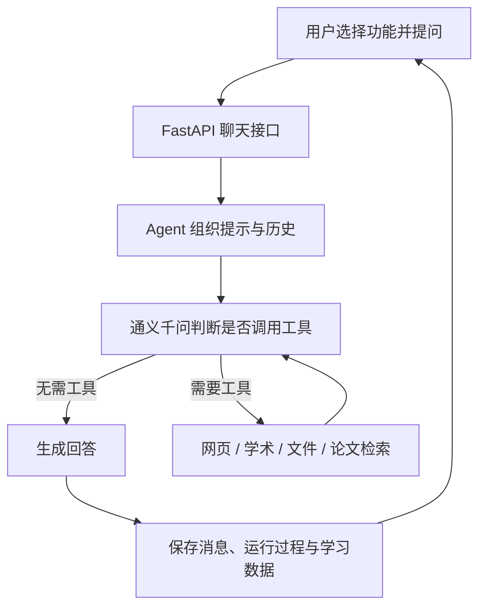

# 知微工作空间

知微工作空间是一个面向研究生学习和科研阅读的个人 AI 助手。它把智能对话、联网搜索、学术论文发现、文件问答、论文阅读和学习档案放在同一个网页中。Agent 可以根据问题决定是否调用工具，并在有限轮次内整合工具结果。

> 当前版本的聊天模型使用通义千问（DashScope）。网页上显示的 Qwen Plus 是当前配置的模型名称；本版本还没有接入 DeepSeek 模型切换。

## 功能

- **智能对话**：进行普通问答；遇到近期信息或用户要求核实时，Agent 可调用网页搜索。
- **联网搜索**：通过 Tavily 搜索网页，返回标题、链接和摘要。需要配置 `TAVILY_API_KEY`。
- **学术论文发现**：查询 Semantic Scholar 和 Crossref，汇总论文标题、作者、年份、摘要、DOI 和数据库提供的开放获取链接；按 DOI 或标题合并重复结果。
- **文件问答**：上传 TXT、PDF、DOCX 后，提取文本并按关键词匹配相关段落；上传 JPG、JPEG、PNG、WEBP 后，直接交给千问视觉模型理解。
- **论文助手**：上传 PDF 后提取全文、切分文本、调用 DashScope Embedding 建立 FAISS 索引；针对当前论文提问时检索相关原文片段，再由模型组织回答。当前只保留一篇活动论文索引。
- **重复文件识别**：根据 SHA-256 检查内容完全相同的文件，尽量复用已有文件；如果重复上传的 PDF 已对应当前索引，则复用现有索引。
- **Agent 过程记录**：记录模型轮次、工具名称、工具参数、执行结果摘要、状态和耗时；聊天记录重新打开后可查看执行过程。
- **学习档案**：用户可以手动保存或删除长期记忆，并根据学习目标生成、更新状态或删除一周学习计划。对话不会自动写入长期记忆。
- **登录保护**：通过访问密码登录；使用 PBKDF2 校验密码，并通过签名的 HTTP-only Cookie 保存会话。
- **自适应界面**：极简风格的响应式网页，可在桌面和手机上使用；支持对话历史、Markdown 回复和接口诊断页面。

## 工作流程



Agent 工具只提供搜索和资料检索，没有任意 Python 执行、Shell 命令执行或任意文件写入能力。工具调用有轮次、单轮工具数量、总耗时、上下文字符数和 token 预算限制，具体值可在环境变量中调整，并受代码硬上限约束。

## 技术栈

| 层次 | 技术 |
| --- | --- |
| 前端 | HTML、CSS、原生 JavaScript、Marked.js |
| 后端 | Python 3.11（推荐）、FastAPI、Pydantic、Uvicorn |
| 大模型 | 通义千问；通过 DashScope OpenAI 兼容接口调用 |
| 联网与学术检索 | Tavily、Semantic Scholar API、Crossref API |
| 文档处理 | PyMuPDF、pypdf、python-docx |
| 论文向量检索 | LangChain 文本切分与集成组件、DashScope `text-embedding-v3`、FAISS |
| 数据存储 | SQLite（聊天、消息、Agent 运行记录、长期记忆和学习计划） |
| 部署 | Nginx 反向代理 + Uvicorn；可使用宝塔面板管理服务器 |

## 项目结构

```text
.
├── backend/
│   ├── main.py                 # FastAPI 路由、登录、上传和静态文件服务
│   ├── agent.py                # Agent 工具调用循环、上下文和执行限制
│   ├── llm.py                  # 千问模型调用
│   ├── database.py             # SQLite 表及数据访问
│   ├── paper_agent.py          # PDF 解析、切片、FAISS 索引和论文检索
│   ├── tools/
│   │   ├── web_search.py       # Tavily 网页搜索
│   │   ├── academic_search.py  # Semantic Scholar 与 Crossref
│   │   ├── file_search.py      # 上传文件文本检索
│   │   └── paper_search.py     # 当前论文向量索引检索
│   ├── requirements.txt
│   ├── uploads/                # 运行时上传文件，不纳入 Git
│   └── paper_index/            # 运行时论文索引，不纳入 Git
├── frontend/
│   ├── index.html
│   ├── app.js
│   ├── style.css
│   └── debug.html              # 接口连接诊断页
├── docs/                       # 架构说明和后续改造计划
├── .env.example                # 配置模板，不含真实密钥
└── start.bat                   # Windows 本地启动脚本
```

## 本地运行

### 环境要求

- Python 3.11 或更新的兼容版本。
- 通义千问 DashScope API Key。
- Tavily API Key 为可选项；没有该 Key 时，普通对话、文件和论文功能仍可运行，但网页搜索不可用。

### Windows PowerShell

在项目根目录运行：

```powershell
py -3.11 -m venv .venv
.\.venv\Scripts\python.exe -m pip install -r backend\requirements.txt
Copy-Item .env.example backend\.env
```

编辑 `backend\.env`，填入自己的配置，然后启动：

```powershell
cd backend
..\.venv\Scripts\python.exe -m uvicorn main:app --host 127.0.0.1 --port 8000
```

浏览器打开 `http://127.0.0.1:8000/`。也可以在准备好 `.env` 和依赖后，从项目根目录双击 `start.bat`。

### Linux

```bash
cd backend
python3.11 -m venv .venv
./.venv/bin/python -m pip install --upgrade pip
./.venv/bin/pip install -r requirements.txt
cp ../.env.example .env
```

填写 `backend/.env` 后启动：

```bash
./.venv/bin/python -m uvicorn main:app --host 127.0.0.1 --port 8000
```

## 环境变量

复制根目录的 `.env.example` 到 `backend/.env`，只在 `backend/.env` 中填写真实密钥和密码配置。**不要把真实密钥提交到 GitHub，也不要写进前端文件。**

| 变量 | 是否必需 | 说明 |
| --- | --- | --- |
| `DASHSCOPE_API_KEY` | 必需 | 千问聊天与论文 Embedding 服务的 API Key |
| `TAVILY_API_KEY` | 可选 | 网页搜索工具的 API Key |
| `SEMANTIC_SCHOLAR_API_KEY` | 可选 | 提高 Semantic Scholar API 的请求能力 |
| `CROSSREF_MAILTO` | 可选 | Crossref polite pool 联系邮箱 |
| `APP_PASSWORD_HASH` | 必需 | 网站访问密码的 PBKDF2-SHA256 哈希，格式为 `salt_hex$hash_hex` |
| `APP_SECRET_KEY` | 必需 | 用于签名登录 Cookie 的随机密钥 |
| `APP_COOKIE_SECURE` | 建议线上设为 `true` | HTTPS 网站应开启 Secure Cookie；本地 HTTP 调试保持 `false` |
| `AGENT_MODEL` | 可选 | 默认 `qwen-plus` |
| `AGENT_VISION_MODEL` | 可选 | 默认 `qwen3-vl-plus`，用于图片问答 |
| `DASHSCOPE_BASE_URL` | 可选 | 默认 DashScope OpenAI 兼容接口地址 |
| `AGENT_MAX_ROUNDS` | 可选 | Agent 最多调用模型的轮数，默认 5，代码硬上限 8 |
| `AGENT_MAX_TOOL_CALLS_PER_ROUND` | 可选 | 每轮最多执行的工具数，默认 3，代码硬上限 5 |
| `AGENT_TOTAL_TIMEOUT` | 可选 | 单次 Agent 总耗时秒数，默认 60，代码硬上限 180 |
| `AGENT_MAX_CONTEXT_CHARS` | 可选 | Agent 上下文字符预算，默认 24000 |
| `AGENT_MAX_TOKENS_PER_RUN` | 可选 | 单次运行 token 预算，默认 12000 |
| `AGENT_MAX_OUTPUT_TOKENS` | 可选 | 单次模型输出 token 上限，默认 1800 |

可用以下命令生成密码哈希和随机签名密钥，再把结果写入 `backend/.env`：

```bash
python -c "import secrets,hashlib; p=input('访问密码: ').encode(); s=secrets.token_bytes(16); print(s.hex()+'$'+hashlib.pbkdf2_hmac('sha256',p,s,310000).hex())"
python -c "import secrets; print(secrets.token_hex(32))"
```

第一条命令输出填入 `APP_PASSWORD_HASH`，第二条输出填入 `APP_SECRET_KEY`。

## 阿里云服务器部署概要

项目由 FastAPI 同时提供 API 和 `frontend/` 静态页面，因此不需要单独启动 Node.js 前端服务。推荐让 Nginx 对外提供 HTTPS，并将请求反向代理到本机 Uvicorn：

```nginx
location / {
    proxy_pass http://127.0.0.1:8000;
    proxy_http_version 1.1;
    proxy_set_header Host $host;
    proxy_set_header X-Real-IP $remote_addr;
    proxy_set_header X-Forwarded-For $proxy_add_x_forwarded_for;
    proxy_set_header X-Forwarded-Proto $scheme;
}
```

将后端、前端和依赖清单上传到服务器；在服务器自己的 `backend/.env` 中配置密钥；使用 Python 3.11 建立虚拟环境并安装 `backend/requirements.txt`；用宝塔 Python 项目管理或 systemd 等进程管理方式启动 Uvicorn。上线前备份旧代码、`.env`、`backend/chats.db`、`backend/uploads/` 和 `backend/paper_index/`。`.env`、数据库、上传文件和索引均是运行数据，不包含在仓库中。

## 主要接口

| 方法与路径 | 用途 |
| --- | --- |
| `GET /auth/status`、`POST /auth/login`、`POST /auth/logout` | 登录状态与会话 |
| `POST /chat` | 统一聊天入口，支持 `chat`、`file`、`paper` 三种模式 |
| `POST /create_chat`、`GET /chats`、`GET /messages/{chat_id}`、`DELETE /delete_chat/{id}` | 聊天会话与消息历史 |
| `POST /upload`、`GET /files` | 上传及列出问答资料 |
| `POST /upload_paper`、`GET /paper_status` | 上传并解析论文、查询索引状态 |
| `GET /agent_runs`、`GET /agent_runs/{run_id}` | 查看 Agent 执行记录 |
| `/memories` | 管理长期记忆 |
| `/learning_plans` | 生成和管理学习计划 |

FastAPI 的 `/docs` 接口文档需要先登录。前端也支持 `/api/` 前缀兼容部署。

## 当前限制

- 学术检索访问 Semantic Scholar 和 Crossref 的公开元数据，不会登录知网、IEEE Xplore 或 ScienceDirect，也不会绕过付费墙或保证获取论文全文。
- 普通文件问答使用关键词和中文双字匹配，不是向量检索；论文助手使用 FAISS 向量检索。
- 论文助手当前维护一个活动索引；解析另一篇论文会替换活动论文索引。相同的当前论文重复上传时可复用索引。
- 扫描版 PDF 如果没有可提取文本，当前论文解析流程会提示无法建立索引；图片问答适用于单张 JPG/JPEG/PNG/WEBP 图片。
- 图片最大 10 MB；普通文件上传最大 20 MB；论文 PDF 最大 50 MB。
- DeepSeek 模型切换目前尚未接入本版本，聊天与学习计划使用配置的千问模型。

## 安全与数据

- `.gitignore` 排除 `.env`、SQLite 数据库、上传文件、FAISS 论文索引、日志和 Python 缓存。请勿强制添加这些文件。
- 公开仓库中不要存放真实 API Key、网站密码或服务器私有数据。若密钥曾经误提交，应立即在对应服务商处撤销并重新生成；仅从最新版本删除并不能清除 Git 历史。
- 网站数据默认保存在服务器本地的 `backend/chats.db`、`backend/uploads/` 和 `backend/paper_index/`。请自行定期备份并限制服务器访问权限。

## 许可证

当前仓库尚未添加开源许可证文件。若要允许他人按特定条件复制、修改或再发布，请在仓库中补充许可证。
