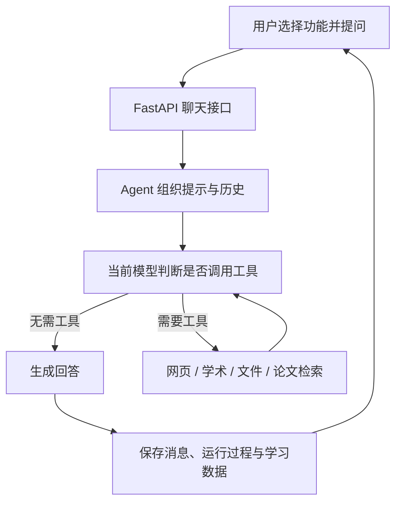

# 知微工作空间

知微工作空间是一个面向研究生学习和科研阅读的个人 AI 助手。它把智能对话、联网搜索、学术论文发现、文件问答、论文阅读和学习档案放在同一个网页中。Agent 可以根据问题决定是否调用工具，并在有限轮次内整合工具结果。

> 模型是可替换的：页面右上角的模型标签打开「模型与 API Key」，可以保存多份服务商配置（通义千问、DeepSeek、OpenAI、智谱、Kimi 或任意 OpenAI 兼容网关），随时切换当前使用的那一份。切换后下一条消息立即生效，不需要重启服务。

## 功能

- **流式输出与中断**：回答逐字推送，生成过程中发送按钮会变成「停止」，点击后后端立即中断本次运行（不再发起新的模型轮次和工具调用），已经生成的文字保留在页面上并写入对话记录。
- **过程可见（回答生成时实时显示）**：回答上方有过程面板，边跑边显示「第几轮 → 调用了哪个工具 → 传了什么参数 → 返回了什么摘要 → 花了多久」；勾选输入框旁的「显示思考」后，支持思考的模型（如 Qwen3 系列、DeepSeek 推理模型）会把推理内容实时流进同一面板。面板在生成结束后折叠为一条可展开的时间线，重新打开历史对话也能看到当时的轮次与思考摘要。
- **模型与 API Key 管理**：在页面上添加多个服务商（预设含通义千问、DeepSeek、OpenAI、智谱 GLM、Kimi，也可填任意 OpenAI 兼容地址），随时切换当前使用的模型。密钥只写入本机 SQLite，接口只回显后四位；「测试连接」会发一次极短的真实请求，确认地址、Key 与模型名是否匹配。图片问答会自动挑选配了视觉模型的服务商，当前服务商不支持时明确提示，而不是硬发一张图给纯文本模型。
- **智能对话**：进行普通问答；遇到近期信息或用户要求核实时，Agent 可调用网页搜索。
- **联网搜索**：通过 Tavily 搜索网页，返回标题、链接和摘要。需要配置 `TAVILY_API_KEY`。
- **学术论文发现**：查询 Semantic Scholar 和 Crossref，汇总论文标题、作者、年份、摘要、DOI 和数据库提供的开放获取链接；按 DOI 或标题合并重复结果。
- **文件问答**：上传 TXT、PDF、DOCX 后，提取文本并按关键词匹配相关段落；上传 JPG、JPEG、PNG、WEBP 后，交给配了视觉模型的服务商理解（DeepSeek 没有视觉模型时会自动改用通义千问等）。
- **论文助手**：上传 PDF 后提取全文、切分文本、调用 DashScope Embedding 建立 FAISS 索引；针对当前论文提问时检索相关原文片段，再由模型组织回答。当前只保留一篇活动论文索引。
- **重复文件识别**：根据 SHA-256 检查内容完全相同的文件，尽量复用已有文件；如果重复上传的 PDF 已对应当前索引，则复用现有索引。
- **Agent 过程记录**：记录模型轮次、工具名称、工具参数、执行结果摘要、思考摘要、状态和耗时；聊天记录重新打开后可查看执行过程。
- **任务规划与待办**：根据学习目标生成 5 到 12 条可勾选任务，显示完成进度；可手动补充任务，并根据已完成进度重新规划未完成任务。
- **学习档案（长期记忆与待办）**：用户可以手动添加长期记忆、勾选学习任务。**默认情况下助手不会写入档案**；只有勾选输入框旁的「允许助手记录」后，助手才能在用户明确要求时调用 `remember`、`list_learning_tasks`、`set_task_status` 三个工具，且写入的记忆会标记来源为「助手写入」，可随时删除。
- **工作区只读工具**：勾选「允许读代码」后，助手可以调用 `list_dir`、`read_file`、`grep_code` 读取项目源码来回答关于代码的问题。这三个工具**只读**，不能修改文件、不能执行命令；访问范围限制在 `AGENT_WORKSPACE` 内，配置（`.env`）、数据库、密钥、依赖目录、上传数据一律不可读。默认关闭。
- **登录保护**：通过访问密码登录；使用 PBKDF2 校验密码，并通过签名的 HTTP-only Cookie 保存会话。
- **自适应界面**：极简风格的响应式网页，可在桌面和手机上使用；支持对话历史、Markdown 回复和接口诊断页面。

## 工作流程



Agent 工具只提供搜索、资料检索、学习档案写入和工作区只读访问，没有任意 Python 执行、Shell 命令执行或任意文件写入能力。档案写入工具默认不注册，需用户显式开启「允许助手记录」；工作区读取工具同样默认不注册，需开启「允许读代码」。工具调用有轮次、单轮工具数量、总耗时、上下文字符数和 token 预算限制，具体值可在环境变量中调整，并受代码硬上限约束。

## 技术栈

| 层次 | 技术 |
| --- | --- |
| 前端 | HTML、CSS、原生 JavaScript、Marked.js |
| 后端 | Python 3.11（推荐）、FastAPI、Pydantic、Uvicorn |
| 大模型 | 可切换：通义千问、DeepSeek、OpenAI、智谱 GLM、Kimi 或任意 OpenAI 兼容接口 |
| 联网与学术检索 | Tavily、Semantic Scholar API、Crossref API |
| 文档处理 | PyMuPDF、pypdf、python-docx |
| 论文向量检索 | LangChain 文本切分与集成组件、DashScope `text-embedding-v3`、FAISS |
| 数据存储 | SQLite（聊天、消息、Agent 运行记录、长期记忆和学习计划） |
| 部署 | Nginx 反向代理 + Uvicorn；可使用宝塔面板管理服务器 |

## 项目结构

```text
.
├── backend/
│   ├── main.py                 # FastAPI 路由、登录、上传和静态文件服务
│   ├── agent.py                # Agent 事件流循环：工具调用、上下文、轮次/时间/token 限制、取消
│   ├── llm.py                  # 模型调用（一次性 + 流式），按当前激活服务商动态取客户端
│   ├── model_store.py          # 服务商预设、API Key 存取、切换与视觉模型降级
│   ├── database.py             # SQLite 表及数据访问
│   ├── paper_agent.py          # PDF 解析、切片、FAISS 索引和论文检索
│   ├── tools/
│   │   ├── web_search.py       # Tavily 网页搜索
│   │   ├── academic_search.py  # Semantic Scholar 与 Crossref
│   │   ├── file_search.py      # 上传文件文本检索
│   │   ├── paper_search.py     # 当前论文向量索引检索
│   │   ├── archive.py          # 学习档案写入（默认不启用）
│   │   └── workspace.py        # 工作区只读访问（默认不启用）
│   ├── requirements.txt
│   ├── test_streaming.py       # 流式事件、工具调用、取消的离线测试（假模型）
│   ├── test_stream_sse.py      # SSE 接口、鉴权与落库的集成测试（临时库）
│   ├── test_thinking.py        # 思考过程、轮次事件与参数降级的离线测试
│   ├── test_providers.py       # 服务商切换、Key 掩码、视觉降级的离线测试
│   ├── test_model_api.py       # 模型配置接口的鉴权与 CRUD 测试
│   ├── uploads/                # 运行时上传文件，不纳入 Git
│   └── paper_index/            # 运行时论文索引，不纳入 Git
├── frontend/
│   ├── index.html
│   ├── app.js
│   ├── style.css
│   └── debug.html              # 接口连接诊断页
├── docs/                       # 架构说明和后续改造计划
├── .env.example                # 配置模板，不含真实密钥
└── start.bat                   # Windows 本地启动脚本
```

## 本地运行

### 环境要求

- Python 3.11 或更新的兼容版本。
- 至少一个大模型 API Key。可以在启动后于页面右上角「模型与 API Key」里填写；如果 `.env` 里已经有 `DASHSCOPE_API_KEY`，首次启动会自动生成一条「通义千问（.env）」配置，不需要重新填。
- Tavily API Key 为可选项；没有该 Key 时，普通对话、文件和论文功能仍可运行，但网页搜索不可用。

### Windows PowerShell

在项目根目录运行：

```powershell
py -3.11 -m venv .venv
.\.venv\Scripts\python.exe -m pip install -r backend\requirements.txt
Copy-Item .env.example backend\.env
```

编辑 `backend\.env`，填入自己的配置，然后启动：

```powershell
cd backend
..\.venv\Scripts\python.exe -m uvicorn main:app --host 127.0.0.1 --port 8000
```

浏览器打开 `http://127.0.0.1:8000/`。也可以在准备好 `.env` 和依赖后，从项目根目录双击 `start.bat`。

### Linux

```bash
cd backend
python3.11 -m venv .venv
./.venv/bin/python -m pip install --upgrade pip
./.venv/bin/pip install -r requirements.txt
cp ../.env.example .env
```

填写 `backend/.env` 后启动：

```bash
./.venv/bin/python -m uvicorn main:app --host 127.0.0.1 --port 8000
```

## 环境变量

复制根目录的 `.env.example` 到 `backend/.env`，只在 `backend/.env` 中填写真实密钥和密码配置。**不要把真实密钥提交到 GitHub，也不要写进前端文件。**

| 变量 | 是否必需 | 说明 |
| --- | --- | --- |
| `DASHSCOPE_API_KEY` | 可选 | 通义千问的 Key，用于首次启动时自动生成默认服务商，以及论文索引的 Embedding。聊天用的 Key 也可以只在页面上配置 |
| `TAVILY_API_KEY` | 可选 | 网页搜索工具的 API Key |
| `SEMANTIC_SCHOLAR_API_KEY` | 可选 | 提高 Semantic Scholar API 的请求能力 |
| `CROSSREF_MAILTO` | 可选 | Crossref polite pool 联系邮箱 |
| `APP_PASSWORD_HASH` | 必需 | 网站访问密码的 PBKDF2-SHA256 哈希，格式为 `salt_hex$hash_hex` |
| `APP_SECRET_KEY` | 必需 | 用于签名登录 Cookie 的随机密钥 |
| `APP_COOKIE_SECURE` | 建议线上设为 `true` | HTTPS 网站应开启 Secure Cookie；本地 HTTP 调试保持 `false` |
| `AGENT_MODEL` | 可选 | 用 `.env` 播种默认服务商时的模型名，默认 `qwen-plus`；页面上的配置优先 |
| `AGENT_VISION_MODEL` | 可选 | 同上，默认 `qwen3-vl-plus`，用于图片问答 |
| `DASHSCOPE_BASE_URL` | 可选 | 用 `.env` 播种默认服务商时的接口地址 |
| `AGENT_MAX_ROUNDS` | 可选 | Agent 最多调用模型的轮数，默认 5，代码硬上限 8 |
| `AGENT_WORKSPACE` | 可选 | 工作区只读工具的根目录，留空则用项目根目录；该目录外与配置/数据/密钥目录一律不可读 |
| `AGENT_MAX_TOOL_CALLS_PER_ROUND` | 可选 | 每轮最多执行的工具数，默认 3，代码硬上限 5 |
| `AGENT_TOTAL_TIMEOUT` | 可选 | 单次 Agent 总耗时秒数，默认 60，代码硬上限 180 |
| `AGENT_MAX_CONTEXT_CHARS` | 可选 | Agent 上下文字符预算，默认 24000 |
| `AGENT_MAX_TOKENS_PER_RUN` | 可选 | 单次运行 token 预算，默认 12000 |
| `AGENT_MAX_OUTPUT_TOKENS` | 可选 | 单次模型输出 token 上限，默认 1800 |

可用以下命令生成密码哈希和随机签名密钥，再把结果写入 `backend/.env`：

```bash
python -c "import secrets,hashlib; p=input('访问密码: ').encode(); s=secrets.token_bytes(16); print(s.hex()+'$'+hashlib.pbkdf2_hmac('sha256',p,s,310000).hex())"
python -c "import secrets; print(secrets.token_hex(32))"
```

第一条命令输出填入 `APP_PASSWORD_HASH`，第二条输出填入 `APP_SECRET_KEY`。

## 阿里云服务器部署概要

项目由 FastAPI 同时提供 API 和 `frontend/` 静态页面，因此不需要单独启动 Node.js 前端服务。推荐让 Nginx 对外提供 HTTPS，并将请求反向代理到本机 Uvicorn：

```nginx
location / {
    proxy_pass http://127.0.0.1:8000;
    proxy_http_version 1.1;
    proxy_set_header Host $host;
    proxy_set_header X-Real-IP $remote_addr;
    proxy_set_header X-Forwarded-For $proxy_add_x_forwarded_for;
    proxy_set_header X-Forwarded-Proto $scheme;
    # 流式回答必须关掉缓冲，否则 Nginx 会把逐字输出攒成一次性返回
    proxy_buffering off;
    proxy_cache off;
    proxy_read_timeout 300s;
}
```

将后端、前端和依赖清单上传到服务器；在服务器自己的 `backend/.env` 中配置密钥；使用 Python 3.11 建立虚拟环境并安装 `backend/requirements.txt`；用宝塔 Python 项目管理或 systemd 等进程管理方式启动 Uvicorn。上线前备份旧代码、`.env`、`backend/chats.db`、`backend/uploads/` 和 `backend/paper_index/`。`.env`、数据库、上传文件和索引均是运行数据，不包含在仓库中。

## 主要接口

| 方法与路径 | 用途 |
| --- | --- |
| `GET /auth/status`、`POST /auth/login`、`POST /auth/logout` | 登录状态与会话 |
| `POST /chat` | 统一聊天入口，支持 `chat`、`file`、`paper` 三种模式；`allow_writes: true` 时才允许助手写入学习档案，`allow_workspace: true` 时才允许只读访问工作区代码，`show_thinking: true` 时请求模型返回思考过程 |
| `POST /chat/stream` | 同一入口的流式版本，返回 `text/event-stream`，逐条推送 `start` / `round` / `reasoning` / `token` / `tool_start` / `tool_end` / `limit` / `error` / `done` 事件。`round` 标出第几轮，`reasoning` 是思考片段（与正文分开，不会混进回答），`tool_end` 带耗时与结果摘要 |
| `POST /chat/cancel/{run_id}` | 请求中断指定的流式运行；Agent 在下一轮或下一次工具调用前退出，状态记为 `cancelled` |
| `POST /create_chat`、`GET /chats`、`GET /messages/{chat_id}`、`DELETE /delete_chat/{id}` | 聊天会话与消息历史 |
| `POST /upload`、`GET /files` | 上传及列出问答资料 |
| `POST /upload_paper`、`GET /paper_status` | 上传并解析论文、查询索引状态 |
| `GET /agent_runs`、`GET /agent_runs/{run_id}` | 查看 Agent 执行记录（含本次使用的服务商与模型） |
| `GET /models`、`POST /models`、`PATCH /models/{id}`、`DELETE /models/{id}` | 模型服务商的增删改查；响应只返回掩码后的 Key |
| `POST /models/{id}/activate` | 切换当前使用的服务商，下一条消息立即生效 |
| `POST /models/test` | 测试连接：可用已保存的 Key，也可测还没保存的草稿 |
| `/memories` | 管理长期记忆 |
| `/learning_plans` | 生成和管理学习计划、任务待办、完成状态与重新规划 |

FastAPI 的 `/docs` 接口文档需要先登录。前端也支持 `/api/` 前缀兼容部署。

## 当前限制

- 学术检索访问 Semantic Scholar 和 Crossref 的公开元数据，不会登录知网、IEEE Xplore 或 ScienceDirect，也不会绕过付费墙或保证获取论文全文。
- 普通文件问答使用关键词和中文双字匹配，不是向量检索；论文助手使用 FAISS 向量检索。
- 论文助手当前维护一个活动索引；解析另一篇论文会替换活动论文索引。相同的当前论文重复上传时可复用索引。
- 扫描版 PDF 如果没有可提取文本，当前论文解析流程会提示无法建立索引；图片问答适用于单张 JPG/JPEG/PNG/WEBP 图片。
- 图片最大 10 MB；普通文件上传最大 20 MB；论文 PDF 最大 50 MB。
- 模型可以在页面上自由切换，但论文索引的 Embedding 仍然只走 DashScope：切换到 DeepSeek 后仍需要一条通义千问配置或 `DASHSCOPE_API_KEY`，否则上传论文会提示缺少 Embedding Key。
- 视觉能力取决于所选服务商：DeepSeek 目前没有视觉模型，图片问答会自动改用其他配了视觉模型的服务商；一个都没有时会直接说明，不会把图片发给纯文本模型。
- `deepseek-reasoner` 这类不支持 function calling 的模型会自动降级为纯对话：能回答问题，但不会联网搜索或检索资料。

## 安全与数据

- `.gitignore` 排除 `.env`、SQLite 数据库、上传文件、FAISS 论文索引、日志和 Python 缓存。请勿强制添加这些文件。
- 公开仓库中不要存放真实 API Key、网站密码或服务器私有数据。若密钥曾经误提交，应立即在对应服务商处撤销并重新生成；仅从最新版本删除并不能清除 Git 历史。
- 网站上保存的模型 API Key 存在 `backend/chats.db` 的 `model_providers` 表里（明文，便于直接调用接口）。它和 `.env` 一样属于本机敏感数据：`*.db` 已在 `.gitignore` 中排除，请勿把数据库文件提交或分享出去；多人共用一台服务器时，应使用系统账号权限限制对该文件的访问。
- 网站数据默认保存在服务器本地的 `backend/chats.db`、`backend/uploads/` 和 `backend/paper_index/`。请自行定期备份并限制服务器访问权限。

## 许可证

当前仓库尚未添加开源许可证文件。若要允许他人按特定条件复制、修改或再发布，请在仓库中补充许可证。
